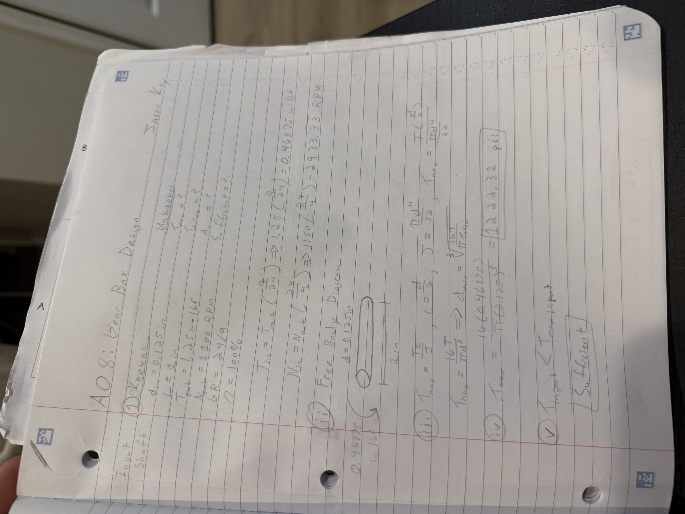
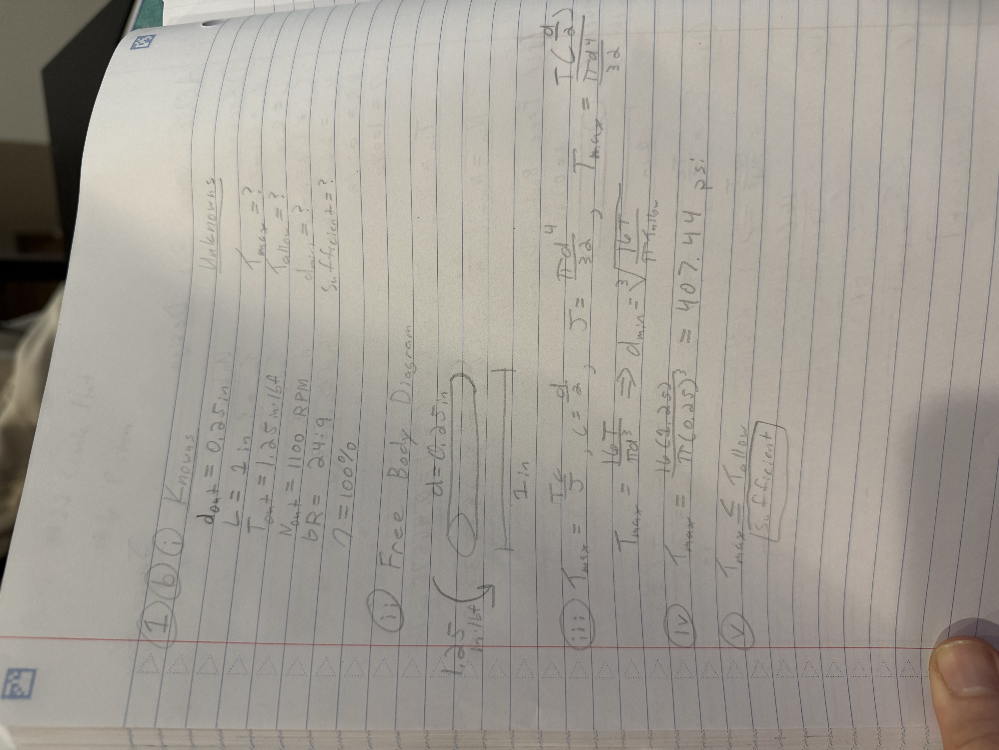
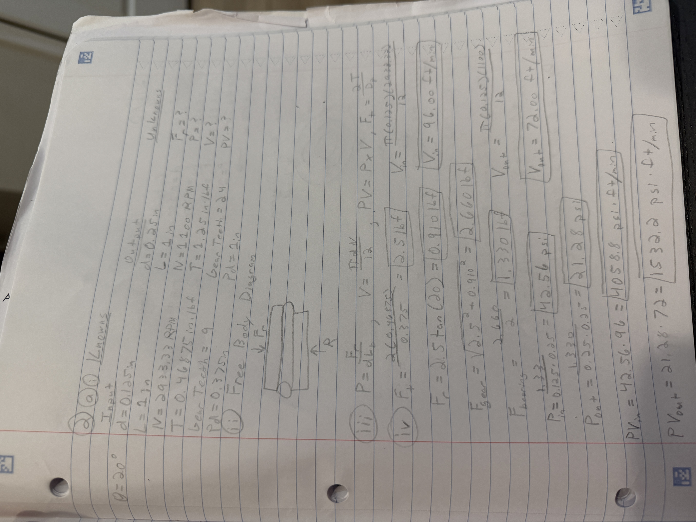
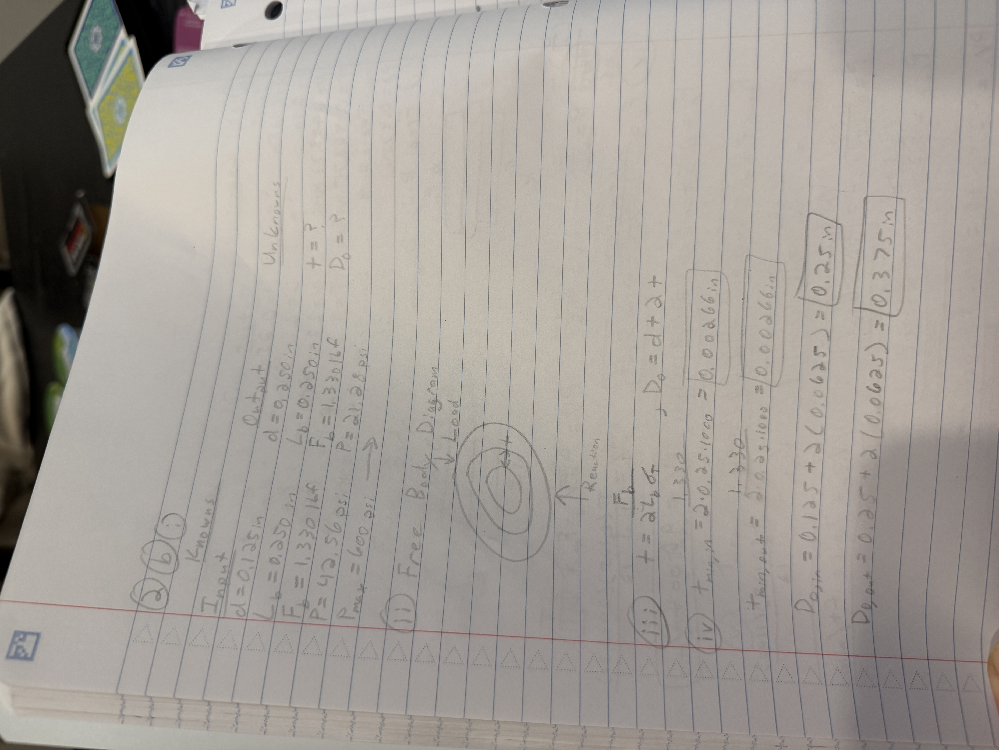
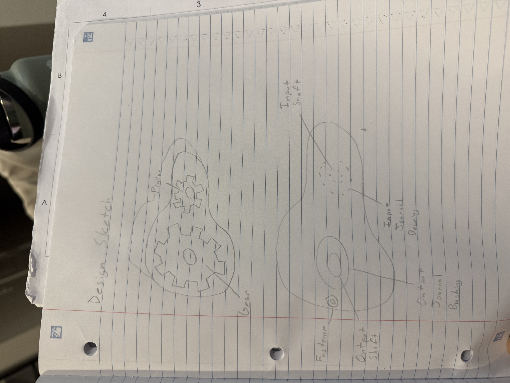

# A8 – Gears

## Objective
  For A08, the main objective is to design, test the structural analysis, and 3D model a gearbox that can be assembled using fasteners. The structural analysis consists of the load on both the 0.125-inch diameter input shaft as well as the 0.250-inch diameter output shaft. A journal bearing evaluation using equations from the Machinery Handbook will also be conducted to find out sizing, pressure velocity, and thickness. The values found using hand calculations will then be used to select the parts from McMaster-Carr website which with then be used in a 3D modeling software to construct the designed gearbox. 

  The gearbox uses a 9-tooth input pinion and a 24-tooth output gear that produces a gear ratio of 24:9. The design called for an output torque of 1.25 in-lbf and an output rotational speef of 1100 RPM. 

## Assumptions

With this assignment, there are multiple assumptions. 

Appropriate strength of shafts using Machinery's Handbook.

The gear train is ideal.

The moment of radial force from the gear train is small enough to be ignored. 

## Calculations for Input and Output Shaft

Using the formulas derived from the Machinery's Handbook, a Tau max input value of 1222.31 psi was found. 

Using the same formulas derived from the Machinery's Handbook, a Tau max output value of 407.44 psi was found. Based on the values of the Tau input and output maxes, the current diameters are sufficient to continue the design. A torque value for the output shaft was found to be 0.46875 in-lbf. 

## Journal Bearings Calculations

For the length of the shafts, I decided to make an assumption of the shafts being 1 inch in length. By having both shafts of equal length, this will help create easy paths of sliding without colliding with the housing walls of the gear box. 

Using the derived equations from the Machinery's Handbook, the values for Force acting upon the gears, the two bearings, Pressure for both the input and output shafts, as well as the Surface Velocity. 

The force acting on thee the gears was found to be 2.660 in-lbf meaning that a Force of 1.330 in-lbf is acting on the bushings. 

The Pressure for the input was 42.56 psi while the pressure for the output was 21.28 psi. 

The surface velocity for the input was found to be 96.00 ft per min while the output velocity was found to be 72.00 ft per min. 

Using both the Pressure and Velocity, the product is a value that will be used to select a material for the bushings. The PV for the input came out to 405.88 psi-ft per min while the output value was 1532.2 psi-ft per min. Using the Bearing Material Limits table from page 2361 in the Machinery's Handbook, I chose to use a material of Lubricated Graphite. The load capacity for this material was 600 psi which well suits the calculated pressures for both the input and output values. A Surface Velocity value of 2500 ft per min also exceeds the needed values for both the input and output. Finally, a PV limit value of 150,000 psi-ft per min also exceeds the calculated values of both input and output values. This material exceeds all needed calculated criteria for this design. 

## Journal Bearings Thickness Calculations

Using the found values for the Journal Bearings, we can then use a free body diagram to calculate the needed thickness of the bearing. 

From these calculations, the thickness needed to be 0.00266 inches for both the input and output shafts. With this thickness, I will be selecting a thickness of 1/16 inch bearing as this measurement is widely available in most commercial uses. 
With this thickness, the dimension for the input diameter was 0.250 inches while the output diameter was 0.375 inches. With these dimensions, I chose to use McMaster-Carr 6391K131 for the Output Shaft Journal. For the Input Shaft Journal, I decided to use McMaster-Carr 6391K111. 

## Design Sketch

For the design sketch, I sketched the gears inside the housing as well as the outside of the housing looking onto the output shaft side of the housing. 

