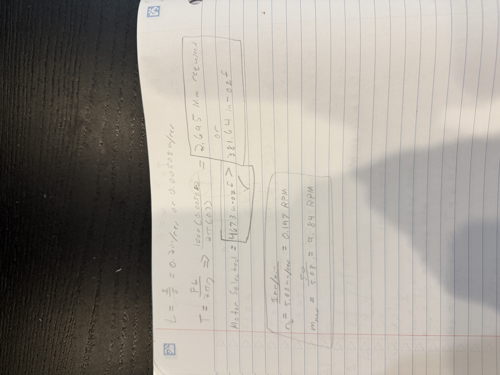
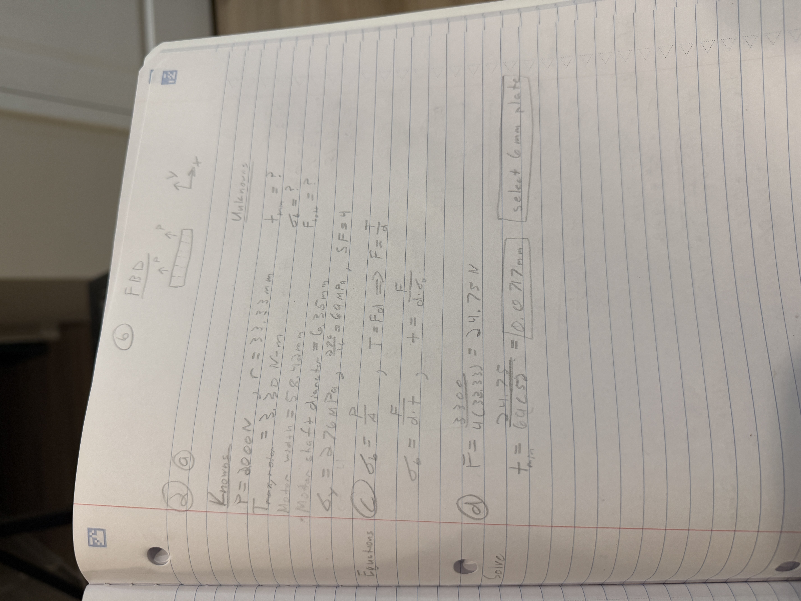
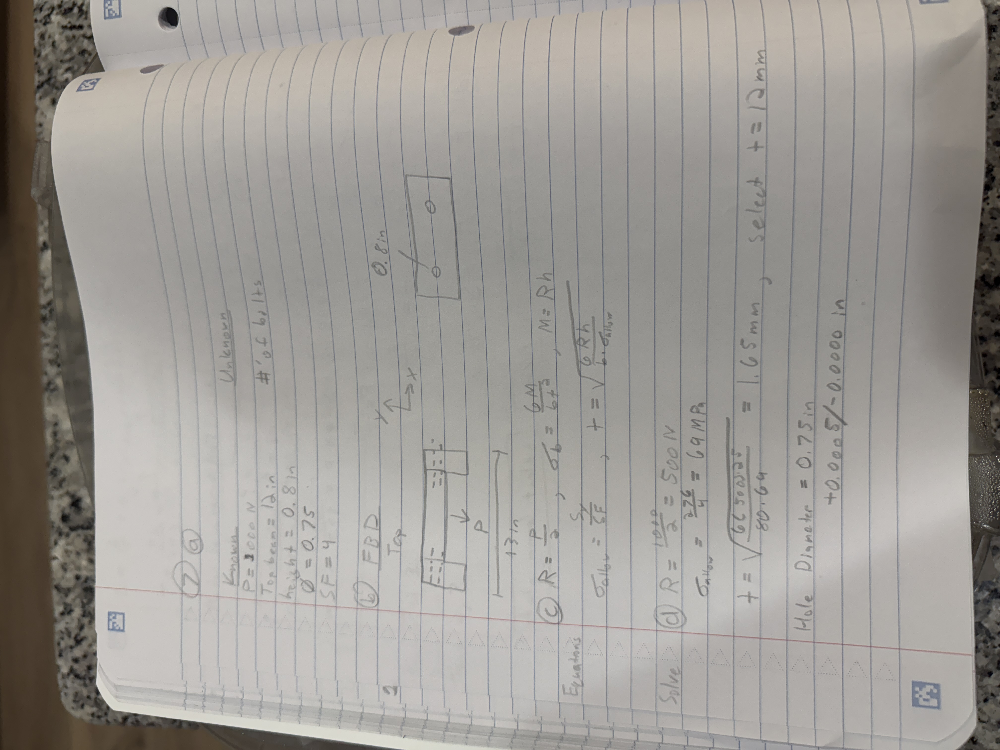

# A11 – Motor Selection

## Objective

The objective of this assignment is to design a motorized drive and frame for a 2 kN tensile tester. Through calculations and design work, a motor needs to be selected, confirm frame integrity, and mounting design for the motor. These design decisions will allow the smooth translation of the crosshead under a safe torque and speed for tensile tester of a high load. Pictured below are the given constraints and values for this assignment. 

## Motor Selection 

For the motor selection, we used values for one half of the needed 2000 N load to find what each motor needed to provide. A 30% efficiency value was used to find a torque value that will not be overused but can still provide the needed torque to translate the crosshead vertically. With these values found, a torque of 2.695 Nm was required or 381.64 in-ozf. A RPM range of 0.197 to 9.84 was calculated to find a motor. From the McMaster website, NEMA 23 6627T923, square body motor was selected. The maximum holding torque is valued at 467.3 in-ozf and a maximum rotation speed of 300 RPM. This motor provided sufficient torque as well as RPM range for our needed values. 

## Motor Bracket Design

After selecting the motor, the next step was to design a bracket that will secure the motor to the frame to ensure the leadscrew to be turned properly. First, the knowns and unknowns were listed then a Free Body Diagram was drawn to further find the needed thickness value to hold the force and torque of the motor. After calculations, the thickness needed to be a minimum of 0.0717 mm. With this in mind, a thickness of the bracket was selected to be 6 mm to hold the motor well with the power required without any issues of mounting. 

Then, a SolidWorks model was created to create a design for our 3D modelled assembly.

This section was completed by Jason. 

## Coupler

For the Coupler, we selected a flexible shaft coupler to connect the motor shafts to the lead screws. We used the coupler specifications to find the maximum torque it could handle and used torsional stress equations to calculate the minimum wall thickness needed. We also checked the selected coupler's dimensions against the calculated thickness to make sure it could handle the twisting force.

## Twist Analysis for Bracket

The Twist Analysis, we looked at the twisting forces created by the two motors and how those forces affect the top of the frame. We calculated the total reaction torque from both motors and used it to determine the forces acting on the frame connections. We also looked at different T-slot brackets, bolts, and connectors that could be used to attach the top horizontal frame to the vertical supports while keeping the frame stable during operation.

## Journal Bearing Mount

Finally, a journal bearing mount is needed to connect the bottom of the leadscrews to the frame. Using the RC 3 fit table 8a in the Machinery's Handbook on page 654, I found the needed tolerance of the diameter to be +0.0005 / -0.0000 inches. Using a Free Body Diagram, a thickness minimum was found to be 1.65 mm but to be safe, I selected a value of 12 mm. A vertically standing mount was chosen with a nominal inner diameter of 19.05 mm and an outer diameter of 40 mm. Then, I modeled the mounting design in SolidWorks. 

| Item Number | Quantity | Name | Cost/Item | Cost | Purchase Link |
| :---: | :---: | :---: | :---: | :---: | :--- |
| 1 | 2 | Stepper Motor | $308.46 | $616.92 | https://www.mcmaster.com/6627T923/ |
| 2 | 2 | Couplers | $413.44 | $826.88 | https://www.mcmaster.com/6259K37/ |
| 3 | 2 | Lead Screw | $35.49 | $70.98 | https://www.mcmaster.com/93255A233/ |
| 4 | 2 | Nut/Flange | $160.09 | $320.18 | https://www.mcmaster.com/95120A123/ |
| 5 | 1 | T-Slot Framing | $245.87 | $245.87 | https://grainger.com |
| | | | **Total Cost** | **$2,080.83** | |

### Design Cost

| Person | Hours worked | cost/ hour | cost |
| :---: | :---: | :---: | :---: |
| Bruno | 10 | 35 | 350 |
| Brandon | 8 | 35 | 280 |
| Jason | 10 | 35 | 350 |
| | | **Total Cost** | **980** |

## Lessons Learned

For this assignment, I learned time management is important when in a group project. I had been studying for a test the day before this assignment was due which caused me to procrastinate finishing my sections of this assignment. Fortunately, my teammates reassured my late finish and was able to finish the project earlier in the night. This is unfair to my teammates as they had to wait on me to progress with their sections. With the ending of the semester coming very close, I will need to manage my time to be able to get to these assignments earlier so that my teammates do not have to wait on me. For this assignment, I had to design two parts that had little requirements meaning I could use more imagination than other designed parts. This was a nice change as I could decide on what the values were to be for dimensions of the mounting parts. I further improved my hand calculations by using equations learned from the past, in class, and in the Machinery's Handbook. In total, I spent about 4 hours for this assignment. 

**Total Cost of Project:** **$3,060.83**

